<p align="center">
  <picture>
    <source media="(prefers-color-scheme: dark)" srcset="assets/logo-dark.svg">
    
  </picture>
</p>

<p align="center">
  A deterministic, strongly typed memory forensics library for Go.<br>
  Windows and Linux memory images &middot; 142 registered tools &middot; two dependencies, both from <code>golang.org/x</code>.
</p>

<p align="center">
  <a href="https://pkg.go.dev/github.com/aoiflux/libvapour"></a>
  <a href="https://github.com/aoiflux/libvapour/tags"></a>
  
  
  
  <a href="LICENSE"></a>
</p>

---

libvapour reads a memory image and tells you about the machine it came from: the
processes that ran, what they had loaded and open, the drivers and hooks in the
kernel, the registry, and the live connections. Each analysis is a **tool**: a
Go package compiled into your program, with a typed `Run` function and a name in
a shared registry.

> [!WARNING]
> **libvapour is early-stage and not ready for casework.** Its output is tested
> on seven real captures. A tool that passes on all seven can still be wrong on
> a build they do not cover. See [Project status](#project-status).

## Contents

- [Highlights](#highlights)
- [Installation](#installation)
- [Quick start](#quick-start)
- [How it works](#how-it-works)
- [Supported images](#supported-images)
- [Tools](#tools)
- [Configuration](#configuration)
- [Writing a tool](#writing-a-tool)
- [Examples](#examples)
- [Validation](#validation)
- [Project status](#project-status)
- [License](#license)

## Highlights

- **A library, not a framework.** No CLI and no runtime loading. Each tool is a
  Go package you import, and its results are Go values.
- **Typed results.** `processlist.Run` returns `[]processlist.Process`,
  `network.Run` returns `[]network.Endpoint`, and so on. A session can also run
  a set of tools by name and gather their results in one report.
- **Deterministic.** One image always gives the same rows in the same order.
- **Gaps are reported.** A diagnostic names what could not be read, such as a
  list walk that stopped early or a page that is not resident. In strict mode,
  131 of the 142 tools return an error instead; the rest still report
  diagnostics. An extracted region comes with a map of its padded bytes.
- **Automatic symbols.** A Windows session identifies the running kernel,
  downloads its symbols from the Microsoft symbol server and caches them. A
  Linux session builds the kernel's symbol table from the image itself.
  `OfflineOnly` keeps air-gapped work offline.
- **Built for hostile input.** Image data is untrusted, and the parsers that
  read it have fuzz targets.
- **Light.** Two dependencies, `golang.org/x/arch` and `golang.org/x/sys`.

## Installation

libvapour needs Go 1.26 or later on amd64 or arm64. 32-bit builds are not
supported.

```bash
go get github.com/aoiflux/libvapour@latest
```

## Quick start

### Run a tool and use its typed result

```go
package main

import (
	"fmt"
	"log"

	"github.com/aoiflux/libvapour"
	"github.com/aoiflux/libvapour/tools/any/processlist"
)

func main() {
	session, err := libvapour.OpenWindowsMemory("memory.raw", libvapour.OpenConfig{})
	if err != nil {
		log.Fatal(err)
	}
	defer session.Close()

	procs, err := processlist.Run(session.Context())
	if err != nil {
		log.Fatal(err)
	}
	for _, p := range procs {
		fmt.Printf("%6d  %s\n", p.PID, p.Name)
	}
}
```

### Run many tools at once

Importing a tool's package registers the tool. Through its own imports, the
root package registers `any.process.list`, `any.process.scan`,
`any.memory.list`, `any.memory.list_pages`, `windows.library.list`,
`windows.module.list`, `windows.network.list`, `windows.network.scan` and
`windows.pe.resolve_symbols`; import any other tool you want, with a blank
import if you only run it by name.

```go
import (
	"github.com/aoiflux/libvapour"
	_ "github.com/aoiflux/libvapour/tools/any/memorycode"
	_ "github.com/aoiflux/libvapour/tools/windows/network" // registers windows.network.scan and windows.network.list
)

report := session.ExecuteAll() // or session.ExecuteSelected([]string{"windows.network.scan", "any.memory.find_code"})
for _, run := range report.Tools {
	if run.Error != nil {
		log.Printf("%s: %v", run.Spec.Name, run.Error)
		continue
	}
	_ = run.Result // the tool's typed result, as an any
}
```

### Linux images

```go
session, err := libvapour.OpenLinuxMemory("memory.lime", libvapour.OpenConfig{})
```

The session takes the kernel's page table and KASLR shift from VMCOREINFO, which
the kernel keeps in memory. Without a symbol table, it builds one from the
image: the kernel's kallsyms, BTF and banner.

> [!NOTE]
> A table given in `SymbolsPath` must come from the kernel's debug information,
> and is used only if it matches the running kernel: its `linux_banner` must be
> the kernel's banner, and VMCOREINFO's symbols must sit where the table puts
> them. An image without VMCOREINFO, or with a 32-bit kernel, is refused.
>
> An image can hold several VMCOREINFO copies. A damaged copy is skipped with a
> diagnostic, and the session fails only when no copy works. With `Strict` set,
> a damaged copy is an error.

## How it works

| Package                                                                            | Role                                                                                                                                                                                                                                                                                        |
| ---------------------------------------------------------------------------------- | ------------------------------------------------------------------------------------------------------------------------------------------------------------------------------------------------------------------------------------------------------------------------------------------- |
| [`memory`](memory)                                                                 | Reads images, detecting the format by content.                                                                                                                                                                                                                                              |
| [`layers`](layers)                                                                 | Translates addresses: x86-64 4- and 5-level, PAE and 32-bit paging with large pages; Windows transition, prototype, pagefile and demand-zero entries; present-only Linux frames. Lists an address space, maps its physical frames, and finds the Windows kernel's page-table root and base. |
| [`symbols`](symbols)                                                               | Loads symbol tables and reads typed values through them. Parses PDBs and downloads them from the Microsoft symbol server.                                                                                                                                                                   |
| [`profiles`](profiles)                                                             | Names each operating system and its pointer size. A tool reads it to refuse an image of an operating system it does not support.                                                                                                                                                            |
| [`objects`](objects)                                                               | Wraps kernel objects over memory and symbols.                                                                                                                                                                                                                                               |
| [`tools`](tools)                                                                   | The registry, the shared `tools.Context`, typed option readers, and one package per tool.                                                                                                                                                                                                   |
| [`scan`](scan)                                                                     | The pool-tag scanning primitive behind the scan-based tools.                                                                                                                                                                                                                                |
| [`extract`](extract)                                                               | Writes a region to disk, with a map of the pages that had to be padded.                                                                                                                                                                                                                     |
| [`pe`](pe), [`disasm`](disasm), [`minidump`](minidump), [`subsection`](subsection) | PE headers and reconstruction, x86 decoding, minidump writing, and prototype-PTE resolution.                                                                                                                                                                                                |
| [`limits`](limits)                                                                 | The bounds on what a session and its tools read, each with its default and ceiling.                                                                                                                                                                                                         |
| [`util`](util)                                                                     | Hashing, alignment and bounded slicing helpers.                                                                                                                                                                                                                                             |

### Opening a session

<picture>
  <source media="(prefers-color-scheme: dark)" srcset="assets/diagrams/session-open-dark.svg">
  
</picture>

Windows symbol tables are cached under
`{os.UserCacheDir}/libvapour/symbols/windows/<version>/` as `.vsym` files, in
libvapour's own symbol-table format ([symbols/FORMAT.md](symbols/FORMAT.md)).
`<version>` is the version of the PDB reader that wrote them; a table from
another version is neither read nor deleted. A table holds the PDB's public
symbols and static functions. With `OfflineOnly` set, a kernel whose symbols are
in neither the cache nor `SymbolsPath` fails to open with
`autoload.ErrSymbolsUnavailableOffline` instead of going to the network.

## Supported images

A session opens **x86-64 Windows** images, and **x86-64 Linux** images whose
kernel keeps a VMCOREINFO table. There is no macOS session.

| Format                                 | Status                                                                               |
| -------------------------------------- | ------------------------------------------------------------------------------------ |
| Raw memory images                      | Supported; tested on real captures                                                   |
| Windows full crash dumps               | Supported; tested on real captures                                                   |
| LiME                                   | Supported; all three Linux captures are LiME. Snappy-compressed LiME is not supported yet |
| ELF core dumps of a machine's memory   | Supported; tested on synthetic fixtures only                                         |
| ELF core dumps of one process          | Refused with `memory.ErrProcessCore`                                                 |
| Windows bitmap and kernel crash dumps  | Refused                                                                              |
| Hibernation files, VMware snapshots    | Not supported yet                                                                    |
| QEMU, Xen and Hyper-V saved states     | Not supported yet                                                                    |
| Pagefiles (`OpenConfig.PagefilePaths`) | Windows builds before 17134 only; tested on synthetic fixtures only                  |

The 32-bit, PAE and 5-level translators exist, but are tested only on synthetic
page tables.

## Tools

142 tools are registered:

- **Windows:** 74 tools are tested on real captures. 8 more are tested on
  synthetic memory only, since no capture holds the state they report.
- **Linux:** 36 tools are tested on real captures, and 9 more are tested on
  synthetic memory only.
- **Placeholders:** `windows.module.list_drivers`,
  `windows.service.find_candidates` and `any.image.find_literal` stand in for
  analyses not built yet. Each description says so.

In the tables below, **Both** means the tool has separate code for Windows and
Linux, and **Any** means one code path serves every image. Expand a group to see
its tools.

<details>
<summary><b>Processes and threads</b> &middot; 27 tools</summary>

| Tool                                   | Platform | Reports                                                                                                                                                                                                                                                                                                        |
| -------------------------------------- | -------- | -------------------------------------------------------------------------------------------------------------------------------------------------------------------------------------------------------------------------------------------------------------------------------------------------------------- |
| `any.process.list`                     | Both     | Active processes. On Windows, the kernel's active process list (`PsActiveProcessHead`), with optional sanity, active-only and snapshot cross-check filters. On Linux, each task's thread and process IDs, parent, name, objective user and group IDs and creation time, and optionally each process's threads. |
| `any.process.tree`                     | Both     | Processes arranged by recorded parent, refusing self-parented and reused parent IDs.                                                                                                                                                                                                                           |
| `any.process.scan`                     | Both     | Processes in physical memory, including those no kernel list holds: on Windows, process pool allocations that pass the process check; on Linux, `task_struct`s found by their empty `ptrace` list heads.                                                                                                       |
| `windows.process.compare`              | Windows  | The processes known to the kernel's two process lists, the session rings, the pool scan, thread owners and csrss.exe handles, each with a verdict: listed, exited, copy, unlisted or hidden.                                                                                                                   |
| `linux.process.list_pid_hash`          | Linux    | Tasks reached from the initial PID namespace's IDR, a view that does not depend on the task list.                                                                                                                                                                                                              |
| `windows.thread.list`                  | Windows  | Each process's threads, with state, wait reason, create and exit times, start addresses and the file or driver they lie in.                                                                                                                                                                                    |
| `windows.thread.scan`                  | Windows  | Threads found by their pool allocations and the thread check, threads no list holds included.                                                                                                                                                                                                                  |
| `windows.thread.list_suspended`        | Windows  | Threads whose suspend count is above zero, with the file and export each start address lies in.                                                                                                                                                                                                                |
| `windows.thread.find_suspicious`       | Windows  | User threads whose start address lies in private memory, in a mapped data file, or in no range of their process.                                                                                                                                                                                               |
| `windows.thread.find_orphaned`         | Windows  | System threads, found by pool scan, that have not terminated and start outside every loaded kernel module.                                                                                                                                                                                                     |
| `windows.thread.check_debug_registers` | Windows  | Threads whose saved user-mode debug registers enable a hardware breakpoint, with the range, file and export of each breakpoint address.                                                                                                                                                                        |
| `linux.thread.list_kernel`             | Linux    | Each kernel thread's thread function and the module and symbol holding it.                                                                                                                                                                                                                                     |
| `linux.process.read_kernel_stack`      | Linux    | Words on each task's kernel stack, from its saved stack pointer up, that name kernel symbols.                                                                                                                                                                                                                  |
| `linux.process.list_tracing`           | Linux    | Tasks traced under ptrace or tracing others, with tracer, tracees and option names.                                                                                                                                                                                                                            |
| `any.process.read_arguments`           | Both     | Command line per process: Linux words and title form, Windows PEB command line.                                                                                                                                                                                                                                |
| `any.process.read_environment`         | Both     | Each process's environment variables: on Windows from the process parameters' block up to its terminator, on Linux from the area between `env_start` and `env_end`.                                                                                                                                            |
| `linux.shell.read_history`             | Linux    | Each Bash shell's history list, and that of any other process using the GNU History Library, found in its private writable memory, in history order with stored time stamps. Processes are chosen by executable and mapped library, not by name. An entry whose time-stamp page is not in memory is left out.  |
| `windows.session.list`                 | Windows  | Processes grouped by logon session, with the session's name and the process's user.                                                                                                                                                                                                                            |
| `windows.token.list_sids`              | Windows  | Each process token's user, group, restricted and capability SIDs with their `SE_GROUP_*` attributes. Each SID is named from Microsoft's documented SIDs, service names, SAM accounts or profile folders, and the row says which source named it.                                                               |
| `windows.token.list_privileges`        | Windows  | Each privilege set in a process token's present, enabled or enabled-by-default mask, by LUID, with its documented constant, privilege string and user right.                                                                                                                                                   |
| `linux.process.list_capabilities`      | Linux    | Each task's inheritable, permitted, effective, bounding and ambient sets.                                                                                                                                                                                                                                      |
| `linux.process.check_credentials`      | Linux    | Credential structures shared by more than one process, marked when one is `init_cred`.                                                                                                                                                                                                                         |
| `windows.job.list`                     | Windows  | Each job object a process belongs to, with the job's accounting and the processes on its list.                                                                                                                                                                                                                 |
| `windows.handle.list`                  | Windows  | Open handles, from each process's handle table, with the object's type and name: its namespace path, a file's device path, a key's registry path, or the process or thread it opens.                                                                                                                           |
| `linux.file.list_open`                 | Linux    | Each task's open descriptors with the name /proc/<pid>/fd gives them and the inode's stat facts.                                                                                                                                                                                                               |
| `windows.process.check_identity`       | Windows  | Processes whose parameter-block image path names another file than the kernel's creation record, whose short name disagrees with it, or whose image path or command line no longer has the loader's layout.                                                                                                    |
| `linux.process.check_identity`         | Linux    | Executable path and name, first argument and comm, with difference flags.                                                                                                                                                                                                                                      |

</details>

<details>
<summary><b>Process memory and modules</b> &middot; 16 tools</summary>

| Tool                             | Platform | Reports                                                                                                                                                                                                                                                                                                                                                                                                                           |
| -------------------------------- | -------- | --------------------------------------------------------------------------------------------------------------------------------------------------------------------------------------------------------------------------------------------------------------------------------------------------------------------------------------------------------------------------------------------------------------------------------- |
| `any.memory.list_pages`          | Windows  | The pages each Windows process maps, from its page-table root, with their offsets in a concatenated dump.                                                                                                                                                                                                                                                                                                                         |
| `any.memory.list`                | Both     | Each process's memory ranges: on Windows its VADs in address order, with protection, kind, mapped file and commit charge; on Linux its VMAs from the maple tree (6.1 onwards) or the VMA list, with protection, file offset, device and inode, and the name `/proc/<pid>/maps` gives each area.                                                                                                                                   |
| `windows.memory.tree`            | Windows  | Each process's VAD tree, one row per kept node with its parent, left and right links and range.                                                                                                                                                                                                                                                                                                                                   |
| `windows.memory.dump`            | Windows  | Each VAD range written to its own file, with unread pages zero-filled and listed as gaps; ranges with no page in the capture or over the dump limit are listed, not written.                                                                                                                                                                                                                                                      |
| `any.memory.find_code`           | Both     | Windows: private and section-view memory that its VAD or page protection lets execute and whose executable pages hold bytes, with page counts, PE header kind and the target of a leading jump or call. Linux: anonymous executable areas, writable-and-executable areas, executable file areas written after mapping, and executable pages in non-executable areas, with the same page counts, header and first-transfer fields. |
| `windows.process.find_hollowing` | Windows  | Processes whose PEB image base, image view, image file names or mapped headers disagree with the image the kernel recorded at process creation.                                                                                                                                                                                                                                                                                   |
| `windows.process.find_ghosting`  | Windows  | Image views and process image files whose file object is delete pending or unnamed, or whose image section has no file object.                                                                                                                                                                                                                                                                                                    |
| `windows.library.list`           | Windows  | Loaded DLLs of each process from the three PEB loader lists, native and WoW64, with load count, load time and list membership.                                                                                                                                                                                                                                                                                                    |
| `windows.library.compare`        | Windows  | Each image view of a process checked against the three loader lists of its PEB; images on no list, or cut from some lists, stand out.                                                                                                                                                                                                                                                                                             |
| `windows.pe.list_imports`        | Windows  | Functions each process's main image imports, from its import directory, with each import address table slot; ordinals are named from the library the process mapped.                                                                                                                                                                                                                                                              |
| `windows.pe.read_version`        | Windows  | Product version from the version resource of every kernel and process module; with the extensive option, a kernel module whose resource is not mapped is matched to a cached copy in physical memory by `OriginalFilename`.                                                                                                                                                                                                       |
| `windows.pe.resolve_symbols`     | Windows  | Names resolved to addresses, or addresses to names, in a module mapped in process or kernel memory, from its PDB and then its export directory.                                                                                                                                                                                                                                                                                   |
| `windows.pe.dump`                | Windows  | Loaded PE images of processes and of the kernel, rebuilt as files; or one image at a given base.                                                                                                                                                                                                                                                                                                                                  |
| `windows.process.dump`           | Windows  | A full-memory minidump per process (system values, modules, threads with stacks and user-mode registers, handles, and only the memory pages present in the capture) that the Windows debugging tools open.                                                                                                                                                                                                                        |
| `linux.memory.list_elf_files`    | Linux    | Memory areas beginning with an ELF header, optionally rebuilt as file images.                                                                                                                                                                                                                                                                                                                                                     |
| `linux.library.list`             | Linux    | Shared objects in the dynamic linker's list per process, or else the ELF images the process maps from file offset 0; `Route` says which.                                                                                                                                                                                                                                                                                          |

</details>

<details>
<summary><b>Kernel and drivers</b> &middot; 31 tools</summary>

| Tool                                  | Platform | Reports                                                                                                                                                                                                                                                              |
| ------------------------------------- | -------- | -------------------------------------------------------------------------------------------------------------------------------------------------------------------------------------------------------------------------------------------------------------------- |
| `windows.kernel.read_info`            | Windows  | Kernel base, page tables, version block, build strings, processor count, shared-data times and the kernel image's PE header fields.                                                                                                                                  |
| `windows.image.read_crash_header`     | Windows  | The header of the Windows crash dump the session reads: kernel pointers, processor count, bug check, dump type, system time and up time.                                                                                                                             |
| `windows.cpu.list`                    | Windows  | Each processor's control region and control block.                                                                                                                                                                                                                   |
| `windows.kernel.list_regions`         | Windows  | The memory manager's assigned system-space regions and the type of each top-level slot.                                                                                                                                                                              |
| `windows.pool.list_big`               | Windows  | The kernel's table of pool allocations of a page or more, which carry no pool header: address, tag, size, page kind and pool type or flags; freed slots on request.                                                                                                  |
| `windows.pool.scan`                   | Windows  | Pool allocations of processes, threads, files, mutants, drivers, symbolic links, atom tables and loaded-module entries found by tag in physical memory, each checked and named, with its kernel address.                                                             |
| `windows.module.list`                 | Both     | Loaded kernel modules: the loader's `PsLoadedModuleList` on Windows (base, size, base name, path), the module list on Linux with each module's regions (from v6.4, `Size` is the text region). The name filter ignores case.                                         |
| `windows.module.scan`                 | Windows  | Kernel loader entries found by their pool allocations, unlinked ones included.                                                                                                                                                                                       |
| `windows.module.list_unloaded`        | Windows  | Unloaded kernel modules from `MmUnloadedDrivers`, each time placed on its clock.                                                                                                                                                                                     |
| `windows.module.list_drivers`         | Windows  | **Placeholder.** Loaded modules named `.sys`; `windows.driver.scan` reads driver objects.                                                                                                                                                                            |
| `windows.driver.scan`                 | Windows  | Driver objects found by their pool allocations, with image range, driver name, service key and object name.                                                                                                                                                          |
| `windows.driver.check_irp`            | Windows  | Each driver's major function table, with the module and symbol of every dispatch routine.                                                                                                                                                                            |
| `windows.driver.find_unbacked`        | Windows  | Driver objects whose `DriverStart` lies in no loaded module; `NoImage` marks objects without an image.                                                                                                                                                               |
| `windows.device.tree`                 | Windows  | Each driver, the devices it created, and the devices attached above each one.                                                                                                                                                                                        |
| `windows.callback.list`               | Windows  | Kernel callback registrations from eleven stores, each with its routine, owning module and the store's detail. x64 only.                                                                                                                                             |
| `windows.timer.list`                  | Windows  | Each processor's timers that queue a DPC, and the module holding the routine.                                                                                                                                                                                        |
| `windows.syscall.list`                | Windows  | The native system service table: routine, stack argument bytes and owning module.                                                                                                                                                                                    |
| `windows.registry.check_cell_routine` | Windows  | Each hive's `GetCellRoutine` and `ReleaseCellRoutine`: in the kernel image (with symbol), in another module, or in none.                                                                                                                                             |
| `linux.module.list`                   | Linux    | Modules on the kernel's module list, with their taints and parameter values.                                                                                                                                                                                         |
| `linux.module.compare_sysfs`          | Linux    | Modules that are on the module list or in sysfs, but not both.                                                                                                                                                                                                       |
| `linux.module.find_hidden`            | Linux    | Modules a scan of module memory finds that are not on the module list.                                                                                                                                                                                               |
| `linux.module.compare`                | Linux    | For each module, which of the module list, sysfs and the scan hold it.                                                                                                                                                                                               |
| `linux.module.dump`                   | Linux    | A relocatable ELF file rebuilt from the module at a given struct module address.                                                                                                                                                                                     |
| `linux.kernel.list_symbols`           | Linux    | Kernel symbols in /proc/kallsyms order: the core image's from its own kallsyms tables, then modules', ftrace's and BPF's.                                                                                                                                            |
| `linux.log.read_kernel`               | Linux    | Kernel log records with sequence, time stamp, facility name and number, level, caller and device, the line decoded and escaped, and whether the record was final, from the lockless ring (5.10+), the record buffer (3.5 to 5.9) or the character ring (before 3.5). |
| `linux.image.read_vmcoreinfo`         | Linux    | Every VMCOREINFO note and its entries as the kernel wrote them; needs no symbols. OSRELEASE shows bytes outside printable ASCII as `\xNN` and a backslash as `\\`, so the text maps back to the bytes exactly.                                                       |
| `linux.kernel.list_io_memory`         | Linux    | The I/O memory resource tree in /proc/iomem order, with depth, flags and names.                                                                                                                                                                                      |
| `linux.boot.read_time`                | Linux    | The time the system booted, once per time namespace, with each namespace's boot-time offset and task count.                                                                                                                                                          |
| `linux.framebuffer.list`              | Linux    | Framebuffers registered with fbdev, their geometry and pixel format; optionally saves screen memory (PNG for packed true colour).                                                                                                                                    |
| `linux.tracing.list_bpf_programs`     | Linux    | The BPF programs in the kernel's `prog_idr`, with ID, type, name, tag, size, JIT state, load time since boot and back-link checks.                                                                                                                                   |
| `linux.tracing.list_perf_events`      | Linux    | The performance events each task opened that run an eBPF program, with the program's identity.                                                                                                                                                                       |

</details>

<details>
<summary><b>Hooks and evasion</b> &middot; 13 tools</summary>

| Tool                                     | Platform | Reports                                                                                                                                                                                             |
| ---------------------------------------- | -------- | --------------------------------------------------------------------------------------------------------------------------------------------------------------------------------------------------- |
| `windows.syscall.find_direct`            | Windows  | Stubs outside ntdll and win32u that issue SYSCALL themselves.                                                                                                                                       |
| `windows.syscall.find_indirect`          | Windows  | Stubs outside ntdll and win32u that jump to a SYSCALL inside them.                                                                                                                                  |
| `windows.syscall.compare_stubs`          | Windows  | ntdll and win32u system-call stubs (64-bit and SysWOW64) compared across processes, with each stub's form and service number.                                                                       |
| `windows.etw.check_patches`              | Windows  | ntdll ETW entry points whose first instruction returns at once or jumps out of ntdll.                                                                                                               |
| `windows.credential.check_kerberos_hook` | Windows  | The Kerberos encryption types registered in `lsass.exe` (cryptdll.dll's crypto-system table), with every routine pointer that lies outside the module that registered its entry.                    |
| `linux.syscall.list`                     | Linux    | Each system-call table entry, the module and symbol its handler lies in, and whether the kernel still dispatches through that table.                                                                |
| `linux.interrupt.check`                  | Linux    | Every interrupt descriptor table gate the CPUs load, where its handler lies, and whether it differs from `idt_table`.                                                                               |
| `linux.network.check_operations`         | Linux    | Checks that the functions behind each /proc/net listing are in the kernel or in the module that holds the listing.                                                                                  |
| `linux.tracing.check_ftrace`             | Linux    | The handlers on `ftrace_ops_list`, their owning module or the kernel, each function they hook (`all` when the filter is empty), and their trampoline's owner. Flag names follow the kernel version. |
| `linux.tracing.check_tracepoints`        | Linux    | The kernel's and modules' tracepoints, their key state and attached probes with owners.                                                                                                             |
| `linux.keyboard.list_notifiers`          | Linux    | The callbacks on the keyboard notifier chain and their owners.                                                                                                                                      |
| `linux.tty.check`                        | Linux    | The receive handlers of each tty's line discipline and the kernel or module code that holds them.                                                                                                   |
| `linux.network.list_hooks`               | Linux    | Netfilter hook functions of every namespace and device, with priority, owner and a check against their registration.                                                                                |

</details>

<details>
<summary><b>Registry</b> &middot; Windows &middot; 13 tools</summary>

| Tool                                    | Reports                                                                                                                                                                                                                                                                                                                                                                 |
| --------------------------------------- | ----------------------------------------------------------------------------------------------------------------------------------------------------------------------------------------------------------------------------------------------------------------------------------------------------------------------------------------------------------------------- |
| `windows.registry.list_hives`           | The loaded registry hives on the kernel's hive list, with their file and registry paths and storage sizes.                                                                                                                                                                                                                                                              |
| `windows.registry.scan_hives`           | Hive objects in big-pool allocations, each verified by its signature, with file and registry paths and whether the hive list links it.                                                                                                                                                                                                                                  |
| `windows.registry.dump_hives`           | Each listed hive's base block and stable storage, written as a hive file; needs the `output_dir` option.                                                                                                                                                                                                                                                                |
| `windows.registry.read_key`             | Subkeys and values at a key path, optionally recursive; a row for each hive where the key is absent or unreadable.                                                                                                                                                                                                                                                      |
| `windows.execution.read_amcache`        | Amcache inventory of program files, applications and driver binaries: path, identifiers, publisher, product, version and link time.                                                                                                                                                                                                                                     |
| `windows.registry.list_autostart`       | Autostart locations documented by Microsoft in the SOFTWARE, SYSTEM and user hives: Run, RunOnce, RunServicesOnce, policy Run, Winlogon Shell and Userinit, AppInit, image debuggers and BootExecute.                                                                                                                                                                   |
| `windows.software.list`                 | Uninstall entries from SOFTWARE (native and Wow6432Node) and from each NTUSER.DAT.                                                                                                                                                                                                                                                                                      |
| `windows.registry.list_mounted_devices` | Mount manager names (drive letters, mount points, volume names) with unique IDs and the volume names sharing them.                                                                                                                                                                                                                                                      |
| `windows.task.list`                     | Scheduled tasks from the SOFTWARE hive's task cache, one row per task: registration text, principal, settings, triggers, actions and last run.                                                                                                                                                                                                                          |
| `windows.execution.read_compat_cache`   | The AppCompatCache value's records: key, file last-write time, data and checksum, most recent first.                                                                                                                                                                                                                                                                    |
| `windows.execution.list_compat_cache`   | The application compatibility cache held by ahcache.sys in kernel memory: each entry's key (file path or package identity), the file's last-write time as the driver saw it, its place in the most-recently-used order and the driver's data bytes, including entries reachable only through the cache's AVL table. Needs the driver's PDB; 32-bit kernels are refused. |
| `windows.registry.read_system_profile`  | Product, build and install values, computer name and time zone values as stored, with install times and UTC offsets.                                                                                                                                                                                                                                                    |
| `windows.execution.read_userassist`     | Explorer's per-user program launch counts from NTUSER.DAT hives, one row per value: decoded name, known folder and expanded path, launch count, last launch time and the stored data.                                                                                                                                                                                   |

</details>

<details>
<summary><b>Services</b> &middot; Windows &middot; 6 tools</summary>

| Tool                              | Reports                                                                                                                                                                                                                                                                                                                                                                                                         |
| --------------------------------- | --------------------------------------------------------------------------------------------------------------------------------------------------------------------------------------------------------------------------------------------------------------------------------------------------------------------------------------------------------------------------------------------------------------- |
| `windows.service.scan`            | Service records found by their tags in `services.exe` private memory: names, type, state, start type, error control, hosting process ID and command line or driver object, whether the SCM's list links the record, and the registry ImagePath and ServiceDll. Layouts measured on x64 builds 14393, 19045 and 26100; on other builds the layout that fits is used, with a diagnostic, and strict mode refuses. |
| `windows.service.read_registry`   | Service keys of the current control set: type, start, error control, tag, image path, display name, account and group.                                                                                                                                                                                                                                                                                          |
| `windows.service.list`            | The Service Control Manager's own list of service records, from the database head that services.pdb names or that a search of the image finds. Layouts measured on x64 builds 14393, 19045 and 26100; on other builds the layout that fits is used, with a diagnostic, and strict mode refuses.                                                                                                                 |
| `windows.service.compare`         | `services.exe` memory against the SCM's list and the registry Services keys: records the list does not link, records with no key, and keys with a service type but no record. Layouts measured on x64 builds 14393, 19045 and 26100; on other builds the layout that fits is used, with a diagnostic, and strict mode refuses.                                                                                  |
| `windows.service.list_sids`       | The service SID of every service key.                                                                                                                                                                                                                                                                                                                                                                           |
| `windows.service.find_candidates` | **Placeholder.** Service host processes (svchost.exe), with the group and service named on their command lines. Reads no service records.                                                                                                                                                                                                                                                                       |

</details>

<details>
<summary><b>Credentials</b> &middot; Windows &middot; 4 tools</summary>

| Tool                                  | Reports                                                                                                                                                                                                               |
| ------------------------------------- | --------------------------------------------------------------------------------------------------------------------------------------------------------------------------------------------------------------------- |
| `windows.credential.read_local`       | Each local account's RID, name and NT and LM password hashes from the SAM hive, unwrapped with the SAM domain key and the SYSTEM hive's system key.                                                                   |
| `windows.credential.read_cached`      | Cached domain logons (`NL$<n>` slots) in the SECURITY hive: account name, logon and DNS domain, RID and 16-byte verifier, decrypted under the `NL$KM` secret. The used-slot layout is not yet confirmed on a capture. |
| `windows.credential.read_lsa_secrets` | Each LSA secret object in the SECURITY hive: name, type, and current and old value with their set times, decrypted under the policy key list that the SYSTEM hive's system key unwraps.                               |
| `windows.credential.find_truecrypt`   | Counted printable strings, candidate cached passphrases, in the writable data sections of `truecrypt.sys`.                                                                                                            |

These tools return secrets. Treat their output as you would the credentials
themselves.

</details>

<details>
<summary><b>Network</b> &middot; 6 tools</summary>

| Tool                            | Platform | Reports                                                                                                                                                                                                                            |
| ------------------------------- | -------- | ---------------------------------------------------------------------------------------------------------------------------------------------------------------------------------------------------------------------------------- |
| `windows.network.scan`          | Windows  | TCP connections, TCP listeners and UDP endpoints found by pool tag in physical memory, including closed connections the tables no longer hold. Builds 14393, 19041 to 19045 and 26100.                                             |
| `windows.network.list`          | Windows  | TCP connections, TCP listeners and UDP endpoints from tcpip.sys's partition hash tables and port pools, with owning process and creation time. Builds 19041 to 19045 and 26100.                                                    |
| `linux.network.list_addresses`  | Linux    | The IPv4 and IPv6 addresses of every device, with prefix length and the kernel's route scope.                                                                                                                                      |
| `linux.network.list_interfaces` | Linux    | Every network device in every namespace, with the flags, state, hardware address and queueing discipline the kernel reports.                                                                                                       |
| `linux.socket.list`             | Linux    | Open sockets per process, followed from descriptor to socket to sock and checked both ways, with namespace, inode and socket filter. Decodes AF_INET, AF_INET6, AF_UNIX, AF_NETLINK, AF_PACKET, AF_XDP, AF_VSOCK and AF_BLUETOOTH. |
| `linux.socket.scan`             | Linux    | Socks in physical memory, live or freed, found by destructor and by file, with whether their socket points back.                                                                                                                   |

</details>

<details>
<summary><b>Files and objects</b> &middot; 11 tools</summary>

| Tool                              | Platform | Reports                                                                                                                                                                                                                                                                          |
| --------------------------------- | -------- | -------------------------------------------------------------------------------------------------------------------------------------------------------------------------------------------------------------------------------------------------------------------------------- |
| `windows.file.scan`               | Windows  | File objects found by their pool allocations, freed ones included, with name, device and access.                                                                                                                                                                                 |
| `windows.file.dump`               | Windows  | Cached file contents from file objects' data, image and shared cache map sections, cut at the file size.                                                                                                                                                                         |
| `windows.ntfs.scan_records`       | Windows  | NTFS file record segments found in physical memory, one row per $STANDARD_INFORMATION or $FILE_NAME attribute, with the four file times, the name and the record's fixup form. Link Count is the record's $FILE_NAME count, DOS names included, not the Windows hard-link count. |
| `windows.ntfs.scan_streams`       | Windows  | Named resident $DATA streams of NTFS file record segments found in physical memory, with their whole value.                                                                                                                                                                      |
| `windows.ntfs.scan_resident_data` | Windows  | Unnamed resident $DATA of NTFS file record segments found in physical memory, with its whole value.                                                                                                                                                                              |
| `windows.object.scan_mutants`     | Windows  | Named mutant objects found by their pool allocations, freed ones included, with the thread that owns each.                                                                                                                                                                       |
| `windows.object.scan_links`       | Windows  | Symbolic link objects found by their pool allocations, freed ones included, with each link's target or callback. When several object headers in one allocation pass equally, the nearest whose name reads is taken.                                                              |
| `linux.mount.list`                | Linux    | The mounts of each mount namespace as /proc/<pid>/mountinfo shows them from a task's root; optionally the /proc/<pid>/mounts options.                                                                                                                                            |
| `linux.pagecache.list_files`      | Linux    | Every inode the kernel holds, with mount-relative path, type, mode, owner, size, cached pages and times.                                                                                                                                                                         |
| `linux.pagecache.list_pages`      | Linux    | An inode's checked cached pages with physical addresses and flags; `dump` writes their content.                                                                                                                                                                                  |
| `linux.pagecache.dump_files`      | Linux    | Cached directories, files and links as a gzip-compressed POSIX tar archive, `pagecache.kernel.tar.gz`. The dump limit bounds each file; the archive limit (`MaxArchiveBytes`, default 16 GiB) bounds their sum.                                                                  |

</details>

<details>
<summary><b>GUI and consoles</b> &middot; Windows &middot; 6 tools</summary>

| Tool                           | Reports                                                                                                                                                                                                                                                                                                                           |
| ------------------------------ | --------------------------------------------------------------------------------------------------------------------------------------------------------------------------------------------------------------------------------------------------------------------------------------------------------------------------------- |
| `windows.console.scan_history` | Command history buffers found by searching conhost.exe memory, with their application, owner PID and commands. Builds 19041 to 19045; other builds, 26100 among them, are refused.                                                                                                                                                |
| `windows.console.list`         | Each console `conhost.exe` hosts: titles, screen buffer size and text, attached processes, aliases and command histories. Builds 19041 to 19045; other builds, 26100 among them, are refused.                                                                                                                                     |
| `windows.gui.scan_stations`    | Window stations found by a pool scan: name, session and kernel address. x64 only; the win32kbase.sys debug record is read through the image section's prototype entry when its page is not mapped; a debug record that does not read, or names no measured build, is refused.                                                     |
| `windows.gui.scan_desktops`    | Desktops found by a pool scan whose window station reads, with the same rows as the list. x64 only; the win32kbase.sys debug record is read through the image section's prototype entry when its page is not mapped; a debug record that does not read, or names no measured build, is refused.                                   |
| `windows.gui.list_desktops`    | Each scanned window station's desktops: one row per desktop thread with its process, and one for a desktop with no threads. x64 only; the win32kbase.sys debug record is read through the image section's prototype entry when its page is not mapped; a debug record that does not read, or names no measured build, is refused. |
| `windows.gui.list_windows`     | Each desktop's window tree: text, window procedure, parent, depth and owning process. x64 only; the win32kbase.sys debug record is read through the image section's prototype entry when its page is not mapped; a debug record that does not read, or names no measured build, is refused.                                       |

</details>

<details>
<summary><b>Timeline, search and export</b> &middot; 9 tools</summary>

| Tool                             | Platform | Reports                                                                                                                                                                                                                                                                                                                                     |
| -------------------------------- | -------- | ------------------------------------------------------------------------------------------------------------------------------------------------------------------------------------------------------------------------------------------------------------------------------------------------------------------------------------------- |
| `any.timeline.list`              | Both     | Every dated event from the process, thread, library, session, socket, link, unloaded-module, task, compat-cache, UserAssist, amcache and NTFS rows (Windows) or the task, boot, shell-history, open-file and page-cache rows (Linux), one entry per time in time order, each naming its tool, row field and object; optionally a body file. |
| `any.image.find_banners`         | Any      | Linux version banners and Windows kernel PDB records in physical memory, with release and version, and a mark on the running kernel's own copy.                                                                                                                                                                                             |
| `windows.image.map_strings`      | Windows  | Each line of a strings listing (decimal file offset, a blank, the string) mapped to every kernel and process virtual address whose page holds it.                                                                                                                                                                                           |
| `windows.kernel.find_pattern`    | Windows  | Matches of a regular expression in the kernel half of the address space.                                                                                                                                                                                                                                                                    |
| `windows.memory.find_pattern`    | Windows  | Matches of a regular expression in each process's VAD ranges, read under the process's own page tables.                                                                                                                                                                                                                                     |
| `linux.memory.find_pattern`      | Linux    | RE2 pattern matches in process memory areas.                                                                                                                                                                                                                                                                                                |
| `any.image.find_literal`         | Any      | **Placeholder.** Fixed byte strings in physical memory, optionally ignoring ASCII case, with offset and a preview; not a pattern-rule engine.                                                                                                                                                                                               |
| `windows.disk.scan_boot_records` | Windows  | Master boot records in physical memory with a well-formed partition table: disk signature, boot code hashes and real-mode listing, partition entries.                                                                                                                                                                                       |
| `any.image.dump_layers`          | Both     | Lists the physical and kernel layers, or writes physical memory as a flat file and the kernel's address space as an ELF core file.                                                                                                                                                                                                          |

</details>

### Reading the rows

- **Strings.** A counted string, such as a `_UNICODE_STRING`, is read to its
  full length and never cut at a NUL. A NUL inside it shows as U+2400 `␀`, and
  text that does not decode shows as U+FFFD `�`.
- **Kernel addresses.** Rows and artifact names give a kernel address in
  canonical form, as the kernel stores it (`0xffff9e03fe7f7260`).
- **Other copies.** The scan tools (pool scans, `any.process.scan`,
  `windows.thread.scan`, `windows.network.scan`, `windows.object.scan_links`,
  the GUI scans) search physical memory. When one allocation is mapped at two
  physical frames, each copy gets its own row, and `OtherCopy`
  (`OtherCopyPhysical` in `windows.network.scan` and `windows.pool.scan`) holds
  the physical offset of the other copy (0 when there is none). Two such rows
  are one object.
- **Process scan.** An `any.process.scan` row must pass the kernel's own
  object-type test: the object header's type must be the Process type. Where
  that test is not possible, the `_DISPATCHER_HEADER`'s Type must be a process.
  A candidate that fails the header test but has a process `_DISPATCHER_HEADER`
  and a valid PID, page-table root and name is still listed, with
  `TypeIndexFailed` set; most are exited processes. `windows.pool.scan` sets
  `TypeIndexFailed` on such an allocation too, and `windows.process.compare`
  marks its row `TypeIndexUnconfirmed`.
- **Network.** An IPv6 socket bound to every address appears on `::` only.
  Whether it also takes IPv4 is not read, and it gets no `0.0.0.0` row. A TCP
  connection's `State` is the name of its `TCPSTATE` value, with the raw value
  in `StateValue`; a value past the eleven TCP states fails the row's checks. A TCP
  listener's `State` is `LISTEN`. A UDP endpoint has no state.
- **Symbolic links.** Some links have no target string: a callback routine
  computes the target each time the link is opened, as for the `\KernelObjects`
  memory and commit condition links. `windows.object.scan_links` lists such a
  link with an empty `Target`, `Callback` set, its `CallbackRoutine` and
  `CallbackContext`, and the routine's module and symbol where known.
- **Hollowing.** `windows.process.find_hollowing` examines each listed process
  that passes the active filter of `ProcessListActiveOnly` (not System, not
  exited, with threads) and has a PEB. A process with no range at its PEB image
  base is reported as not examined, not as a finding, when the VAD walk read
  fewer VADs than `VadCount` or the process is a secure process.

## Configuration

### Session options

`libvapour.OpenConfig` controls how a session opens and how its tools run.

| Field                       | Effect                                                                                                                                                                                                                                                                                                                                                                           |
| --------------------------- | -------------------------------------------------------------------------------------------------------------------------------------------------------------------------------------------------------------------------------------------------------------------------------------------------------------------------------------------------------------------------------- |
| `SymbolsPath`               | A kernel symbol table to use instead of loading one automatically: a `.vsym` file in libvapour's format ([symbols/FORMAT.md](symbols/FORMAT.md)), the only one read. It is checked against the image.                                                                                                                                                                            |
| `OfflineOnly`               | Forbids symbol downloads. The kernel's symbols, and any module's a tool asks for, must come from the cache or `SymbolsPath`.                                                                                                                                                                                                                                                     |
| `KernelCR3`                 | The kernel's page-table root. The session finds it itself (on Linux from VMCOREINFO), and a value set here must be that one, or the open fails.                                                                                                                                                                                                                                  |
| `Strict`                    | Fails fast on recoverable traversal errors, in the 131 tools that check it. The other tools report such errors as diagnostics.                                                                                                                                                                                                                                                    |
| `CollectDiagnostics`        | Collects non-fatal warnings for review.                                                                                                                                                                                                                                                                                                                                          |
| `PID`                       | Names one process for the tools that read the `pid` option; 0 leaves it unset.                                                                                                                                                                                                                                                                                                   |
| `ProcessListActiveOnly`     | Keeps only active processes: a valid `_EPROCESS` with active threads and no exit time, that is not System (PID 4). System's children, such as Registry and MemCompression, are kept.                                                                                                                                                                                             |
| `ProcessListSanityFilter`   | Removes implausible process-list rows, which helps on smeared images.                                                                                                                                                                                                                                                                                                            |
| `ProcessListCrossCheck`     | Confirms process-list rows against a process snapshot from another source.                                                                                                                                                                                                                                                                                                       |
| `ProcessListCrossCheckCSV`  | Loads that snapshot from a CSV file (see [Process cross-check](#process-cross-check)). Set with `ProcessListCrossCheck`, rows are confirmed against the union of the two; the caller's slice is not modified.                                                                                                                                                                    |
| `NetworkScanIncludeCorrupt` | Includes partially decoded `windows.network.scan` rows.                                                                                                                                                                                                                                                                                                                          |
| `PagefilePaths`             | Pagefile images, indexed by pagefile number, so swapped-out pages can be read. Without them, a swapped page is reported as `layers.ErrPageInPagefile`, never read as zeroes.                                                                                                                                                                                                     |
| `ToolOptions`               | Per-tool options, passed into `tools.Context.Options`. The typed fields above take precedence.                                                                                                                                                                                                                                                                                   |
| `Limits`                    | Bounds what the session and its tools read: list and table entries, nesting, name, text and buffer sizes, scanned bytes, the PTE cache, workers, output sizes and the total size of a page-cache archive (`MaxArchiveBytes`, default 16 GiB). A zero field takes its documented default (`limits/limits.go`); a negative value, or one over the field's ceiling, fails the open. |
| `SymbolLoad`                | Where Windows symbols are cached and downloaded from (`CacheDir`, `ServerURL`), the download timeout and size bound (`HTTPTimeout`, `MaxDownload`), and how large a symbol table may be. A value it cannot take fails the open.                                                                                                                                                  |

### Tool options

Tools read their options through typed readers (`tools/options.go`). An option
of the wrong type fails the tool's run with an error that names the option and
wraps `tools.ErrOptionType`. A key no tool reads is left alone.

| Type    | Accepted values                                                               |
| ------- | ----------------------------------------------------------------------------- |
| Boolean | A `bool`, or the words `1`, `true`, `yes`, `on`, `0`, `false`, `no` and `off` |
| Number  | Any Go integer type that is not negative, or decimal or `0x` text             |
| List    | A `[]string`, or for numbers a `[]uint64` or `[]int`; or comma-separated text |

<details>
<summary><b>The <code>pid</code> option</b></summary>

- Give one PID as a number, or several as a `[]uint64`, a `[]int` or
  comma-separated text (`"4,1234"`).
- 0 means PID 0, not every process. Only an absent `pid` means every process.
- An empty `pid` (`""`, an empty slice), or one with an empty item, is refused.
- Rows stay in the order the tool walks the processes.
- `OpenConfig.PID` names one process, and 0 leaves it unset. Give PID 0, or
  several PIDs, in `ToolOptions["pid"]`.

</details>

<details>
<summary><b>Addressing a process, file or image directly</b></summary>

- `windows.handle.list.offset` and `windows.library.list.offset` name one
  process by the physical address of its `_EPROCESS`, as the pool scan finds it,
  which can be an unlinked process. 0 means no offset. They are read from
  Windows 8 on, and refused on earlier builds.
  - `pid` still applies: when `pid` is given and does not name the process at
    that offset, no row is listed, and a diagnostic says which PID the offset
    holds.
- `windows.file.dump.virtaddr` and `windows.file.dump.physaddr` carve the file
  objects at the kernel or physical addresses given, in order.
  - `pid` is then not applied, and an address given twice is carved once.
  - `windows.file.dump.filter` keeps the file objects whose name, with its
    device (`\Device\HarddiskVolume3\...`), contains the pattern. Case is
    ignored under `windows.file.dump.ignore_case`.
  - A filter cannot be given together with an address.
- `windows.pe.dump.base` reconstructs the PE at one address.
  - It reads the PE in each process `pid` names, or, with
    `windows.pe.dump.kernel_module`, in the kernel's address space.
  - A base needs `pid` or `windows.pe.dump.kernel_module`, and the two cannot be
    given together.
  - The artifact is `image.pid<pid>.<base>.<_EPROCESS>.pe`, or
    `image.kernel.<base>.pe` with `windows.pe.dump.kernel_module`.
  - Without a base, `windows.pe.dump` carves every module of every loader list.

</details>

<details>
<summary><b>Patterns</b></summary>

A pattern such as `windows.library.list.name` is a Go RE2 regular expression,
searched for anywhere in the text.

- A pattern that RE2 cannot compile is refused. Every other pattern is taken as
  RE2 reads it: `{,n}` is literal text, and a flag group such as `(?i)` applies
  from where it stands to the end of its group.
- `\d`, `\w`, `\s`, `\b` and `\B` match ASCII only; `(?i)` uses Unicode simple
  case folding; `$` without `(?m)` matches only at the end.
- The kernel and memory find_pattern tools match bytes, one character per byte:
  `\xff` matches the byte 0xff.

</details>

### Process cross-check

`processlist.LoadSnapshotCSV` reads a process snapshot from a CSV file for
`ProcessListCrossCheck`. Its first record names the columns, matched without
regard to case or surrounding spaces. A UTF-8 byte-order mark and a `#TYPE`
line before that record are skipped.

| Column              | Accepted names                      |
| ------------------- | ----------------------------------- |
| PID (required)      | `ProcessId`, `PID`, `Id`            |
| Image name          | `Name`, `Image Name`, `ProcessName` |
| `_EPROCESS` address | `EPROCESS`                          |

A PID is decimal. An address is decimal, or hexadecimal after `0x`.

```go
rows, err := processlist.LoadSnapshotCSV("processes.csv")
if err != nil {
	log.Fatal(err)
}
cfg := libvapour.OpenConfig{
	ProcessListActiveOnly: true,
	ProcessListCrossCheck: rows,
}
```

Or let the session load the file itself:

```go
cfg := libvapour.OpenConfig{
	ProcessListActiveOnly:    true,
	ProcessListCrossCheckCSV: "processes.csv",
}
```

## Writing a tool

A tool is a package under `tools/`. It exposes a typed `Run`, and registers a
`RunAny` adapter by name, so a session can run it alongside the others:

```go
package mytool

import "github.com/aoiflux/libvapour/tools"

// Register refuses a name that is not platform.subject.verb in lower case.
const Name = "any.example.list"

func init() {
	tools.MustRegister(tools.Spec{Name: Name, Description: "What mytool reports"}, RunAny)
}

type Result struct {
	Value uint64
}

func Run(ctx tools.Context) ([]Result, error) {
	// Read memory through ctx.Memory and types through ctx.Symbols.
	return nil, nil
}

func RunAny(ctx tools.Context) (any, error) { return Run(ctx) }
```

Helpers used only by tests live under `internal/testsupport`.

## Examples

Runnable programs are in [`examples/`](examples). Each needs a memory image you
supply; none is bundled.

| Example                                        | What it does                                                                                                                                |
| ---------------------------------------------- | ------------------------------------------------------------------------------------------------------------------------------------------- |
| [`examples/processes`](examples/processes)     | The process tree with command lines and the kernel's modules; with `-pid`, one process's DLLs and threads, or libraries.                    |
| [`examples/memory`](examples/memory)           | One process's memory ranges; on Windows, with `-out`, its minidump and one file per range.                                                  |
| [`examples/registry`](examples/registry)       | A registry key's subkeys and values. Windows only.                                                                                          |
| [`examples/network`](examples/network)         | Network endpoints: `windows.network.list` and `windows.network.scan` on Windows, `linux.socket.list` on Linux.                              |
| [`examples/timeline`](examples/timeline)       | Every dated event in time order (time, event, tool, field, subject); with `-out`, a body file.                                              |
| [`examples/triage`](examples/triage)           | Tamper checks: `any.memory.find_code`, `windows.process.compare` and `windows.library.compare` on Windows, `any.memory.find_code` on Linux. |
| [`examples/processlist`](examples/processlist) | Opens a session and prints the process list.                                                                                                |
| [`examples/showcase`](examples/showcase)       | Runs every tool for the image's platform and prints a table for each result, plus a report file and a summary.                              |

The first six call each tool's typed `Run`. The
[examples README](examples/README.md) describes each program and its flags.

```bash
go run ./examples/processes -pid 4242 memory.raw
go run ./examples/processlist memory.raw
go run ./examples/processlist -os linux memory.lime
go run ./examples/showcase memory.raw
go run ./examples/showcase -max-rows 50 -pid 4 memory.raw
go run ./examples/showcase -process-list-cross-check-csv processes.csv memory.raw
```

Put flags before the image path. Go's flag parsing stops at the first non-flag
argument, so a flag after the path is an error.

The showcase skips `any.memory.list_pages` unless a PID is given (`-pid` or
`-opt pid=`) or `-tools` names the tool: across every process it yields
millions of page runs.
It also skips `any.timeline.list`, which repeats the timed rows of the other
tools, and `linux.kernel.list_symbols`, which lists every kernel symbol, unless
`-tools` names them. The report header names each skip and its reason.
`-max-rows N` prints at most N rows of each table on stdout; the report file
holds every row.

> [!CAUTION]
> By default the showcase prints credentials as `[redacted]`, sizes included, on
> stdout and in the report file: windows.credential.read_local's LM and NT
> hashes, windows.credential.read_cached's verifiers, and
> windows.credential.read_lsa_secrets' secrets and old values, and
> windows.credential.find_truecrypt's passphrases and their lengths. Accounts,
> domains and secret names are still printed. `-reveal-secrets` prints the
> credentials themselves; for windows.credential.read_lsa_secrets that is each
> secret's size and its first 32 bytes, in hex. **If you use it, keep the
> terminal log and the report file to yourself.**

## Validation

<picture>
  <source media="(prefers-color-scheme: dark)" srcset="assets/diagrams/validation-dark.svg">
  
</picture>

| Gate                                                       | What a green run means                                                                 |
| ---------------------------------------------------------- | -------------------------------------------------------------------------------------- |
| `go test ./...`                                            | The unit tests pass on synthetic fixtures, and no file git would commit is over 20 MB. |
| `go vet ./...`, `staticcheck ./...`                        | No vet or lint finding, with and without `-tags realimage`.                            |
| `go test -run '^$' -fuzz <target> -fuzztime 30s <package>` | The fuzz target finds no crash in 30 seconds. Go runs one fuzz target per call.        |

The gates above run without an image. Real-image tests run locally on private
captures and are not published. The captures:

| Capture             | Build or kernel |
| ------------------- | --------------- |
| Windows 10          | 19045           |
| Windows 11          | 26100           |
| Windows Server 2016 | 14393           |
| Windows Server 2025 | 26100           |
| Ubuntu 24           | Linux 6.17      |
| Fedora 40           | Linux 6.14      |
| Fedora 40           | Linux 6.14      |

`any.timeline.list` and `any.image.dump_layers` have no real-image test. Images
and test outputs stay local and are never committed.

## Project status

libvapour is at **v0.1.0**. It is early-stage, and these limits matter most:

- **Narrow image support.** Only x86-64 Windows, and x86-64 Linux with
  VMCOREINFO, open; see [Supported images](#supported-images).
- **Linux on two kernels.** The Linux tools are tested on Ubuntu 24 (6.17) and
  Fedora 40 (6.14) only.
- **Few real captures.** Four Windows and three Linux. A tool that passes on all
  of them can still be wrong on a build they do not cover.
- **No acquisition yet.** The acquisition provider contract
  (`memory/acquire.go`) is defined, but no backend captures live memory: they
  read an image file or a reader the caller passes.

## License

libvapour is released under the [MIT License](LICENSE).

<p align="center">
  <picture>
    <source media="(prefers-color-scheme: dark)" srcset="assets/wordmark-dark.svg">
    
  </picture>
</p>
